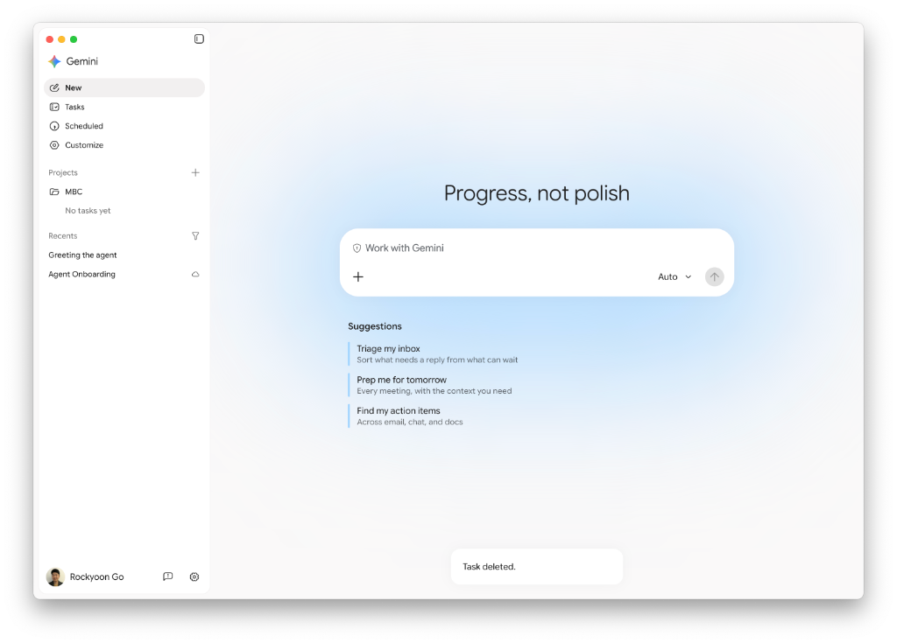

# LG CNS · Antigravity & Gemini 개발자 실습 가이드

> **파일 다운로드 0건 · 순수 프롬프트 기반 개발자 핸즈온**  
> 별도 첨부파일이나 ZIP 다운로드 없이, **빈 로컬 Git 폴더 하나만 열고 프롬프트를 날려** 코드 생성 · 동시성 디버깅 · 브라우저 E2E 검증 · Hook/MCP 설정까지 바로 완주합니다.

---

## 0. 전체 커리큘럼 로드맵 & 1줄 초기 세팅

| 파트 | 시간 (90분 / 180분) | 핵심 주제 | 개발자 실습 포인트 (첨부파일 불필요) |
| :--- | :---: | :--- | :--- |
| **Part 0** | 10분 / 15분 | 환경 세팅 · 무중단 조향 · Gateway | 기업 계정 로그인(앱·CLI·VS Code), `Turbo`, `/btw`, `admin_config.json` |
| **Part 1** | 25분 / 45분 | 설계 인터뷰 ~ 브라우저 자율 E2E | `/grill-me` ➔ `/plan` ➔ `/goal` + `/browser`로 정산 API·대시보드 생성 및 디버깅 |
| **Part 2** | 25분 / 50분 | 4종 모델 비교 · 엔지니어링 벤치마크 | `Carbon · Neon · Hydrogen · Gluon`, 데드락·그래프·보안 패치, Zero Harness Tax |
| **Part 3** | 15분 / 35분 | 멀티에이전트 분업 · 자산화 · 전환 | `/boost` 적대적 검증, `/teamwork` Git 워크트리 병렬 구현, `/learn` · `/plugin` |
| **Part 4** | 10분 / 20분 | Hook & MCP 프롬프트 세팅 | `.agents/hooks.json` 위험 명령 하드 차단, 로컬 Python Stdio MCP 서버 생성 |
| **Part 5** | 5분 / 15분 | Gemini 데스크탑 앱 미리보기 | 코딩(Antigravity) vs 일상 업무(Gemini 데스크탑), 전사 `SKILL.md` 공유 |

1️⃣ **실습 시작 전 터미널에서 빈 Git 작업 폴더 하나만 만들고 Antigravity로 엽니다** (`/boost`, `/teamwork` Git 워크트리 격리에 사용):

```bash
mkdir -p ~/lgcns-agy-lab && cd ~/lgcns-agy-lab && git init
```

---

# 💻 Part 0. 환경 세팅 · 무중단 제어 & 엔터프라이즈 거버넌스

### 🔹 Step 0-1. 기업 계정 2단계 로그인 (앱 · CLI · VS Code 공통)

> **핵심:** 개인 Gmail이 아닌 **기업 Google Cloud 계정**으로 로그인해야 사내 라이선스 쿼터와 보안 정책이 적용됩니다.

1️⃣ 첫 화면에서 회색 **`Use Business Account`** 버튼을 클릭합니다. (`Continue with Google` 클릭 금지)


2️⃣ 다음 화면에서 파란색 **`Continue with Google Cloud`**를 눌러 인증을 완료합니다. (`Antigravity 앱`, 터미널 `agy` CLI, `VS Code 확장` 모두 동일)


---

### 🔹 Step 0-2. 멈추지 않는 실시간 조향 (`Turbo` · `/btw`) & Gateway 통제

1️⃣ **권한 프리셋 전환 (`Turbo`)**: 로컬 샌드박스 실습 중 매번 터미널 승인을 누르기 번거롭다면 입력창 우측 하단 모드를 **`Turbo`**로 전환합니다.


2️⃣ **작업 중 끼어들기(`Send Immediately`) & 사이드 질문(`/btw`)**: 에이전트가 빌드·테스트를 돌리는 도중에도 `Stop` 없이 조건을 추가하거나, 메인 컨텍스트 오염 없이 환경 확인 질문을 던질 수 있습니다.

```text
/btw 현재 로컬 Python 버전과 비어 있는 로컬호스트 포트 번호 하나만 짧게 확인해줘.
```

3️⃣ **Enterprise Gateway & MDM 일괄 제어 (`admin_config.json`)**:
- **사내 Proxy 연동**: LiteLLM 및 자체 LLM 게이트웨이·중앙 GCP 서비스 계정으로 트래픽과 과금을 일원화합니다.
- **동일 보안 정책**: `admin_config.json` MDM 배포 하나로 앱 · CLI · VS Code 확장의 허용 모델과 도메인 URL을 동시에 통제합니다.

---

# 🛠️ Part 1. 설계 리뷰 ~ 브라우저 자율 E2E 디버깅

### 🔹 Step 1-1. `/grill-me` 역질문 설계 인터뷰 ➔ `/plan` 아키텍처 합의

> **핵심:** 모호한 프롬프트로 바로 수백 줄 코드를 짜게 하지 않고, 에이전트가 먼저 **예외 케이스와 스펙 빈틈을 역질문(`/grill-me`)**하게 한 뒤 구현 계획서(`/plan`)에 줄 단위 코멘트를 달아 통제합니다.

1️⃣ 빈 작업 폴더에서 `/grill-me` 칩을 선택하고 아래 프롬프트를 보냅니다.

```text
/grill-me 중복 결제 방지(Idempotency)와 부분 환불 정산을 지원하는 주문 정산 웹 대시보드를 단일 파이썬 서버와 HTML로 만들 건데, 코딩 전에 엣지 케이스와 정산 규칙부터 나에게 질문해줘.
```

2️⃣ 에이전트의 객관식 질문 카드에 답한 뒤, `/plan`으로 구현 및 자가 테스트 계획을 먼저 받습니다. (계획서 특정 문장을 드래그해 인라인 코멘트로 조건을 수정할 수 있습니다.)

```text
/plan 방금 합의한 규칙대로 서버, 대시보드 UI, 그리고 화면 내장 Self-Test 6개 항목을 구현하는 계획서를 작성해줘.
```

---

### 🔹 Step 1-2. `/goal` + `/browser` 로컬 서버 기동 & 자율 디버깅 완주

> **핵심:** 개발자가 수동으로 브라우저를 새로고침하며 콘솔 에러를 찾는 대신, 에이전트가 직접 로컬 서버와 크롬을 띄워 **모든 E2E 항목이 PASS할 때까지 스스로 패치·재검증(`/goal`)**합니다.

1️⃣ `/goal`을 선택하고 아래 한 줄을 입력해 구현부터 브라우저 E2E 검증까지 위임합니다.

```text
/goal 계획대로 서버를 띄우고 크롬 브라우저로 직접 접속해 중복 클릭·부분 환불·0건 조회 Self-Test 6개 항목이 전부 PASS가 뜰 때까지 스스로 디버깅해줘.
```

2️⃣ 실패 항목(`FAIL`)이 발견되면 에이전트가 콘솔 로그와 DOM 상태를 읽고 코드를 고쳐 전체 **`PASS`**까지 완주하는 루프를 확인합니다.


---

### 🔹 Step 1-3. `/generative_ui` 대화창 인라인 아키텍처 계산기 생성

> **핵심:** 프론트엔드 보일러플레이트를 만들지 않고도, 아키텍처 용량 산정이나 트래픽 시뮬레이터를 채팅창 안에 즉시 렌더링해 조작할 수 있습니다.

```text
/generative_ui 초당 요청 수(RPS), 타임아웃 비율, 재시도 횟수를 슬라이더로 조절하면 재시도 증폭 트래픽과 서킷브레이커 개방 시점을 실시간 계산해주는 위젯을 띄워줘.
```


---

# 🧠 Part 2. 4종 모델 체급 비교 & 엔지니어링 벤치마크

### 🔹 Step 2-1. 4종 모델 라인업(`Carbon ~ Gluon`) & 단일 프롬프트 물리 엔진 비교

| 모델 라인업 | 권장 엔지니어링 역할 | 언제 선택하나? |
| :--- | :--- | :--- |
| **Gemini 4 Carbon** | 최고난도 추론 · 아키텍처 · 1M 컨텍스트 | 동시성·데드락 분석, 보안 감사, 복잡한 알고리즘·3D 물리 원샷 구현 |
| **Gemini 4 Neon** | 고성능 균형 엔지니어링 | 중대형 기능 개발, 다중 모듈 리팩토링, 복합 버그 디버깅 |
| **Gemini 4 Hydrogen** | 주력 고속 코딩 · 반복 구현 | 일상적인 API·UI 구현, 단위 테스트 작성, 빠른 브라우저 검증 루프 |
| **Gemini 4 Gluon** | 초경량 · 초저지연 단순 작업 | 보일러플레이트 생성, 포맷 변환, 짧은 코드 요약 및 대량 반복 작업 |

1️⃣ 새 대화창 두 개를 열어 하나는 **`Hydrogen`**, 다른 하나는 **`Carbon`**으로 맞춘 뒤 동일 프롬프트를 보내 충돌 처리·물리 완성도를 비교합니다.

```text
외부 에셋 없이 단일 HTML 파일 하나로 탄성 변형과 장애물 충돌 회피가 실시간 동작하는 3D 자율주행 로봇 시뮬레이터를 만들어줘.
```


---

### 🔹 Step 2-2. 파일 없이 바로 돌려보는 개발자 벤치마크 프롬프팅 3선

> **핵심:** 별도 데이터셋 없이도 아래 **동시성 데드락 · 그래프 알고리즘 · 취약점 무중단 패치** 프롬프트 한 줄씩이면 `Hydrogen`과 `Carbon`의 추론 깊이를 즉시 체감할 수 있습니다.

1️⃣ **[벤치 A — 멀티스레드 데드락 & Race Condition 재현·해결]**

```text
멀티스레드 환경에서 두 계좌 간 동시 이체 시 데드락과 잔액 정합성 깨짐을 재현하는 파이썬 코드와 pytest를 먼저 작성하고, 락 순서 정렬로 해결해 테스트를 통과시켜줘.
```

2️⃣ **[벤치 B — MSA 순환 의존성 & 단일 장애점(SPOF) 탐지기 구현]**

```text
20개 마이크로서비스 호출 그래프를 생성하고 코드 실행 전 Tarjan 알고리즘 기반 순환 의존성과 단일 장애점 탐지 로직을 설계한 뒤, 시각화 콘솔과 단위 테스트로 검증해줘.
```

3️⃣ **[벤치 C — 취약 레거시 코드 생성 후 테스트 무수정 보안 패치]**

```text
SQL 인젝션과 부동소수점 금액 오차가 있는 레거시 정산 모듈과 이를 검증하는 pytest 8개를 먼저 만든 뒤, 테스트 파일은 절대 건드리지 말고 모듈만 패치해 전부 통과시켜줘.
```

---

### 🔹 Step 2-3. 토큰 효율 확인(`/context`) & Zero Harness Tax

1️⃣ **토큰 및 코드 밀도 즉시 확인**: CLI/앱에서 `/context`로 소모 토큰을 확인하고 생성된 코드 줄 수와 비교합니다.

```bash
wc -l *.py *.html
```

2️⃣ **왜 전용 CLI 대신 단일 Antigravity 하네스인가? (`Zero Harness Tax`)**:
- **동등 이상의 해결 정확도**: DeepSWE v1.1 · Terminal-Bench 4.0 기준 전용 하네스(Claude Code · Codex) 대비 품질 손실 없이 동등 이상의 Pass@1을 기록합니다.
- **12% 이내 토큰 경제성**: 표준 단가 기준 모든 구간에서 네이티브 하네스 대비 12% 이내 비용 효율을 유지하며, 일상 코딩은 `Hydrogen · Gluon`으로 비용을 추가 절감합니다.
- **단일 거버넌스 표준화**: 모델마다 도구를 쪼개지 않고 하나의 Antigravity 환경으로 통일합니다.

---

# 🤝 Part 3. 멀티에이전트 분업 · 팀 자산화 & 전환

### 🔹 Step 3-1. `/boost` 적대적 교차 검증 & `/teamwork` 파일 독점 병렬 구현

> **핵심:** 단일 모듈의 **깊은 알고리즘·동시성 검증은 `/boost`**(작성자 추론 폐기 후 백지 검증), 여러 모듈을 **동시에 빠르게 구축할 때는 `/teamwork`**(워커별 파일 소유권 분리)를 선택합니다.


1️⃣ **`/boost` 실습 (Worker 1 구현 ➔ Worker 2 백지 상태에서 공격 테스트 작성)**:

```text
/boost 토큰 버킷 기반 분산 Rate Limiter를 구현하고, 별도 검증 워커가 동시성 경합과 경계값 공격 테스트를 새로 작성해 교차 검증해줘.
```

2️⃣ **`/teamwork` 실습 (충돌 없는 파일 독점 병렬 구현)**: 우측 `Subagents` 패널에서 워커들이 각자 맡은 파일만 동시에 작성하고 통합 테스트를 통과시키는 과정을 확인합니다.

```text
/teamwork JWT 인증 미들웨어, 주문 API 라우터, 부하 테스트 스크립트를 각각 별도 파일 소유권으로 나누어 병렬로 구현하고 pytest로 통합 검증해줘.
```


---

### 🔹 Step 3-2. `/learn` · `/plugin` 팀 자산화 & Claude Code 전환 매핑

1️⃣ **`/learn`으로 코딩·테스트 불변 규칙 영구 저장** (`.agents/rules/` 자동 생성):

```text
/learn 금액 연산에는 float 대신 Decimal만 사용하고 SQL 쿼리는 반드시 파라미터 바인딩만 허용한다는 규칙을 프로젝트 룰로 저장해줘.
```

2️⃣ **`/plugin`으로 팀 배포용 번들 패키징** (`plugin.json` + `rules/` + `skills/` 자동 구조화):

```text
/plugin 방금 만든 보안·정산 규칙과 코드 리뷰 체크리스트 스킬을 묶어서 팀원들에게 바로 배포할 수 있는 로컬 플러그인 폴더로 패키징해줘.
```


3️⃣ **기존 Claude Code 사용자 1:1 전환 매핑**:

| 기존 개념 | Antigravity 대응 | 현장 전환 포인트 |
| :--- | :--- | :--- |
| `Slash Commands` | `/grill-me` · `/plan` · `/goal` · `/boost` | 설계 인터뷰부터 브라우저 검증·교차검증까지 1줄 호출 |
| `CLAUDE.md · Rules` | `.agents/rules/` · `AGENTS.md` | 기존 마크다운 규칙 재작성 없이 그대로 인식 + `/learn` 자동 추출 |
| `Skills · Hooks · Plugin` | `.agents/skills/` · `.agents/hooks.json` | 검증된 `SKILL.md`와 가드 스크립트를 폴더 하나로 묶어 팀 배포 |
| 단일 모델 고정 | `Carbon · Neon · Hydrogen · Gluon` | 고난도 설계는 `Carbon`, 반복 편집·검증은 `Hydrogen · Gluon` |

---

# 🔌 Part 4. Hook & MCPs (프롬프트로 즉시 구축)

### 🔹 Step 4-1. Hook 설정법 (`.agents/hooks.json` 자동 생성 및 차단 검증)

> **핵심:** 마크다운 `Rule`이 모델에게 주는 가이드라인이라면, **`Hook`(`hooks.json`)은 도구 실행 직전(`PreToolUse`)·직후(`PostToolUse`)에 스크립트를 100% 강제 실행**하는 코드 레벨 안전장치입니다.

| 주요 이벤트 | 실행 시점 | 대표 엔지니어링 활용 |
| :--- | :--- | :--- |
| **`PreToolUse`** | `run_command` 등 실행 직전 | `rm -rf`, `DROP TABLE`, `git push --force` 하드 차단 (`"decision": "deny"`) |
| **`PostToolUse`** | 파일 편집·명령 완료 직후 | 코드 수정 직후 `ruff` / `eslint` / `pytest` 자동 실행 |
| **`SessionStart` / `Stop`** | 세션 시작 / 루프 종료 시 | 런타임 환경 점검, 사내 감사 로그 기록 |

1️⃣ **손으로 JSON을 짤 필요 없이 프롬프트 한 줄로 `.agents/hooks.json`과 가드 스크립트를 생성합니다**:

```text
.agents/hooks.json과 파이썬 가드 스크립트를 생성해서, run_command 실행 직전(PreToolUse)에 rm -rf, DROP TABLE, git push --force 문자열이 포함되면 deny로 즉시 차단하게 설정해줘.
```

<details class="file-list-details">
<summary><strong>📄 생성되는 `.agents/hooks.json` 표준 규약 확인하기 (클릭하여 펼치기)</strong></summary>

```python
# .agents/hooks.json
{
  "safety-guard": {
    "PreToolUse": [{
      "matcher": "run_command",
      "hooks": [{ "type": "command", "command": "python3 ./guard.py", "timeout": 5 }]
    }]
  }
}
# stdin 입력: {"toolCall": {"name": "run_command", "args": {"CommandLine": "..."}}}
# stdout 반환: {"decision": "deny", "reason": "위험 명령 차단"}  (allow | deny | ask | force_ask)
```

</details>

2️⃣ **차단 동작 즉시 테스트**: 아래 프롬프트를 보내 에이전트가 명령을 실행하기 전에 Hook이 가로채 차단하는지 확인합니다.

```text
방금 설정한 Hook이 실제로 작동하는지 확인하게 DROP TABLE users 문자열이 들어간 echo 명령을 터미널에서 실행해봐.
```

---

### 🔹 Step 4-2. MCP 설정법 (`mcp_config.json` 로컬 서버 생성 & 연동)

> **핵심:** 사내 DB·이슈 트래커·인프라 API를 **Model Context Protocol(MCP)**로 연결하면 에이전트가 네이티브 도구처럼 호출합니다.

| 연결 방식 (Transport) | 필수 키 | 추천 용도 |
| :--- | :--- | :--- |
| **1. 로컬 Stdio** | `"command"`, `"args"`, `"env"` | 로컬 Python/Node 스크립트, SQLite/Git/Docker CLI 브리지 |
| **2. 원격 Streamable HTTP** | `"url": "https://.../mcp"` | 사내 Cloud Run · GKE 등에 배포된 중앙 MCP 게이트웨이 (`/mcp` 엔드포인트) |

1️⃣ **프롬프트 한 줄로 외부 패키지 없는 순수 Python 로컬 MCP 서버와 설정 파일을 바로 만듭니다**:

```text
외부 라이브러리 설치 없이 파이썬 표준 라이브러리만으로 현재 Git 브랜치 상태와 로컬 포트 목록을 반환하는 Stdio MCP 서버 스크립트를 짜고, mcp_config.json 등록 예시까지 보여줘.
```

2️⃣ **설정 경로 및 UI 확인**:
- 전역 설정은 **`~/.gemini/config/mcp_config.json`**, 플러그인 배포 시에는 **`plugins/<이름>/mcp_config.json`**에 위치합니다.
- 우측 상단 **`Additional Options (...)` ➔ `MCP Servers`** 메뉴에서 연결 상태와 노출된 도구 목록을 바로 확인할 수 있습니다.

---

# 🖥️ Part 5. Gemini 데스크탑 앱 미리보기

### 🔹 Step 5-1. 코딩은 Antigravity, 일반 업무는 Gemini 데스크탑

> **핵심:** 코드 작성·빌드·디버깅은 **Antigravity**에서 수행하고, 메일 분류·미팅 준비·문서 정리 같은 전사 일상 업무는 전용 **Gemini 데스크탑 앱(및 웹)**으로 깔끔하게 분리합니다.



1️⃣ **좌측 메뉴 4대 핵심 구성**:
- **`Tasks`**: 백그라운드에서 진행 중이거나 내 확인·승인을 기다리는 비동기 업무 함
- **`Scheduled`**: 매일 아침 브리핑·주간 기술 동향 요약 등 정기 자동 실행 루틴
- **`Customize`**: 나만의 `Skills` · `Memory` · 사내 연결 앱(Workspace, Jira 등) 관리
- **`Projects`**: 프로젝트 기획서·아키텍처 문서를 폴더 단위로 묶어 일관된 맥락 유지

2️⃣ **개발자·현업 공통 일상 업무 시나리오**:
- **메일함 우선순위 분류 (`Triage my inbox`)**: 장애 알림·리뷰 요청 등 급한 메일과 참고 메일 자동 분류
- **미팅 사전 브리핑 (`Prep me for tomorrow`)**: 캘린더 일정과 관련 설계 문서를 엮어 핵심 쟁점 요약
- **액션 아이템 추출 (`Find my action items`)**: 메일·채팅·회의록에 흩어진 내 할 일 자동 수집

---

### 🔹 Step 5-2. 동일한 `SKILL.md` 표준으로 개발팀 ↔ 전사 연결

1️⃣ **코딩 없이 30초 만에 만드는 텍스트 `Skill`**:
- `Skills ➔ + Create skill` 화면에서 **`① 이름` · `② 설명` · `③ 안내(지침)`** 3칸만 적으면 즉시 `/my-skill` 단축키가 만들어집니다.


2️⃣ **개발팀이 만든 표준 스킬·거버넌스 전사 재사용**:
- 개발 조직이 Antigravity에서 검증한 `.md` / `.zip` 스킬(`SKILL.md`)과 사내 MCP · Agent Gateway 보안 정책이 **Gemini 데스크탑과 웹에도 동일한 표준으로 연결**되어, 개발팀의 엔지니어링 자산이 전사 AX 표준으로 직결됩니다.
