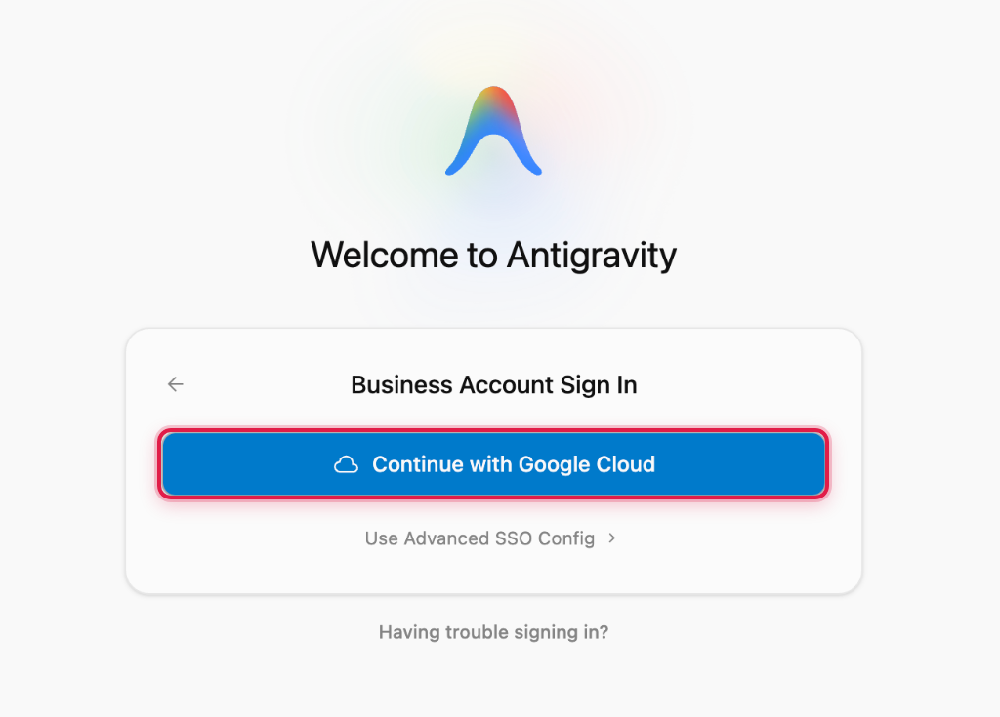
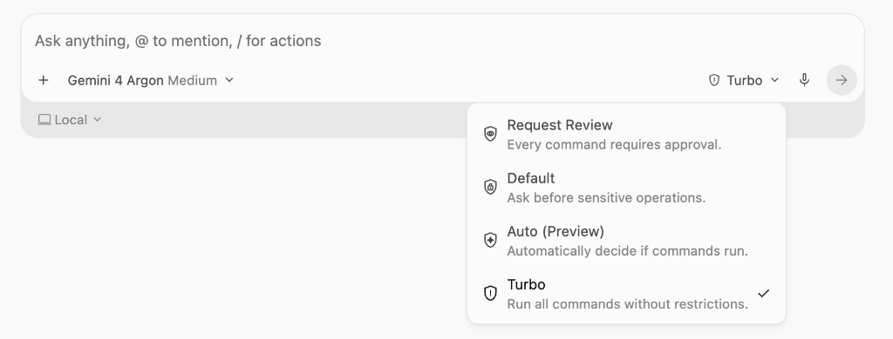
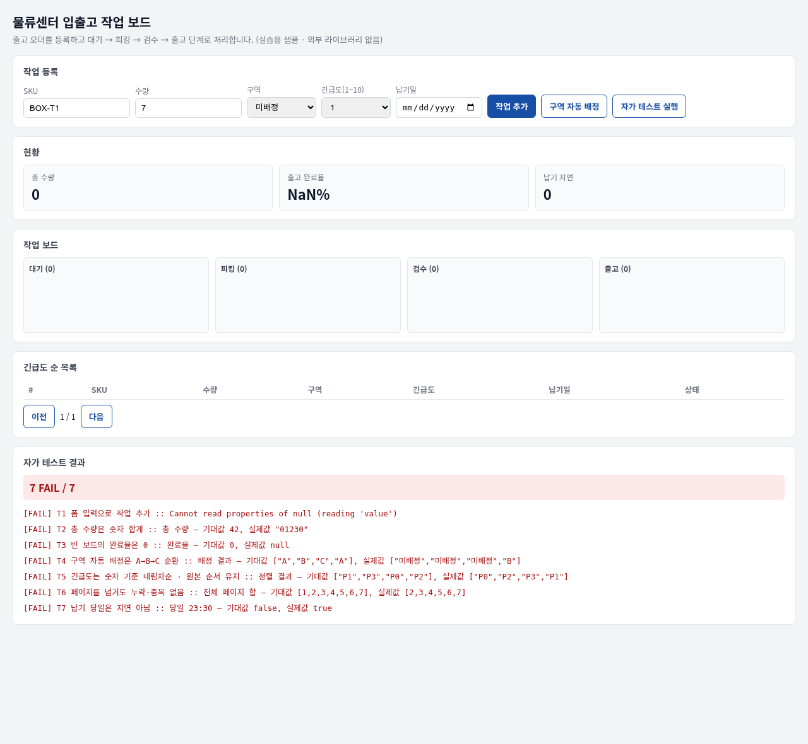
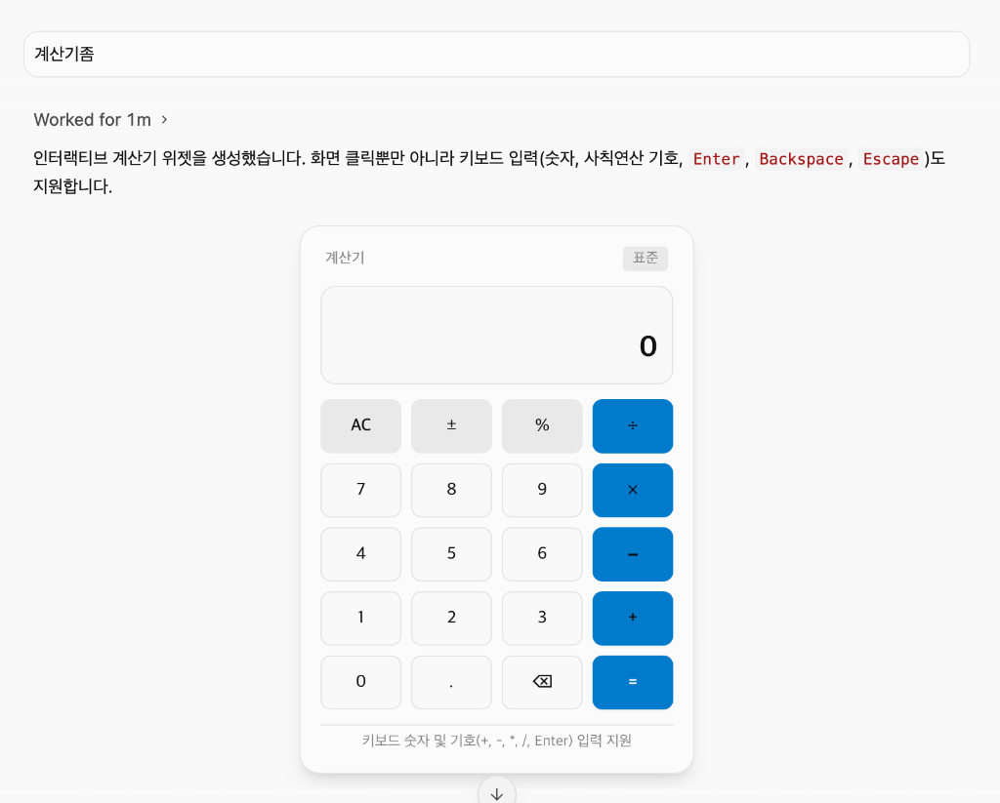
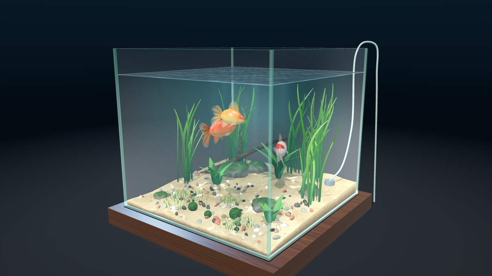
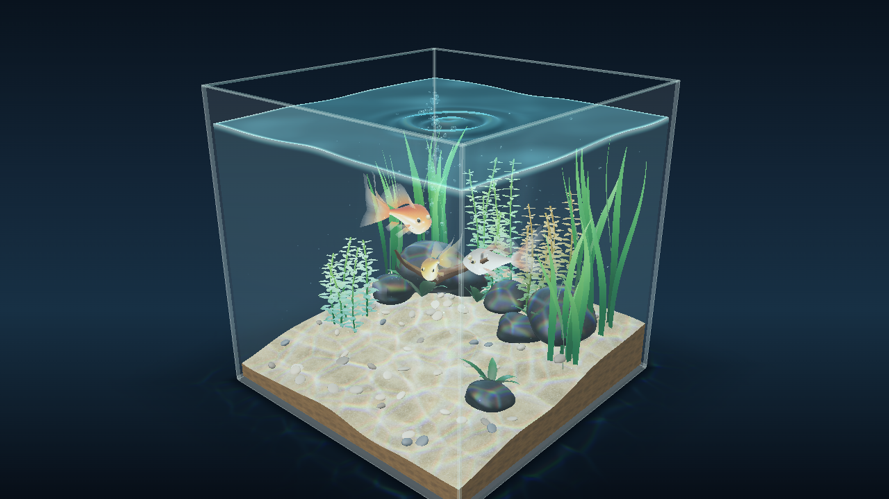
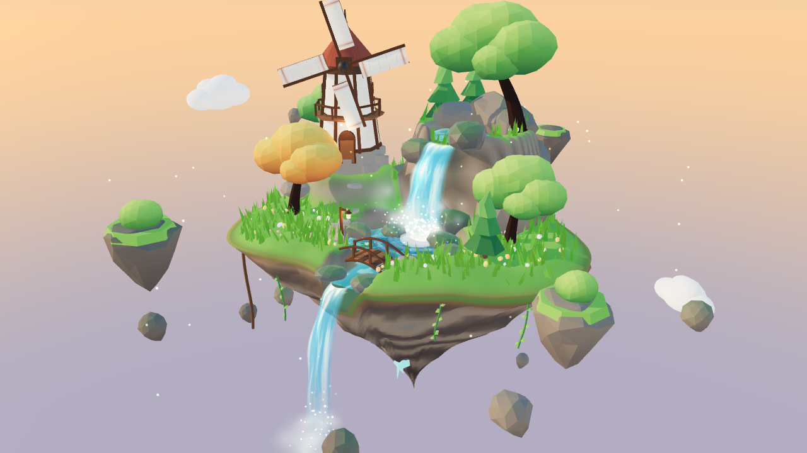
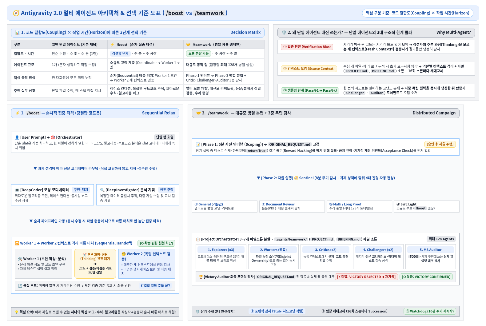
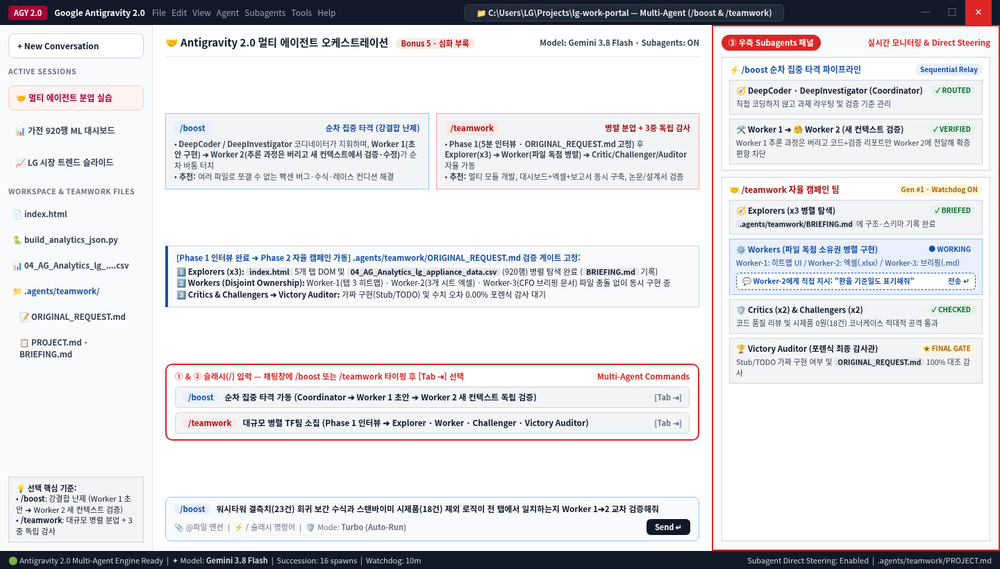

# LG CNS · Antigravity & Gemini 개발자 실습 가이드

> **파일 다운로드 0건 · 실무 눈높이 프롬프트 실습**  
> 별도 첨부파일이나 브라우저 원격 제어 설정 없이 **빈 폴더 하나만 열고**, 현업에서 동료 개발자에게 말하듯 자연스러운 한 줄 프롬프트를 날려 설계 · 코딩 · 터미널 자동 검증 · Hook/MCP 설정까지 바로 체험합니다.

---

## 0. 전체 커리큘럼 로드맵 & 1줄 초기 세팅

| 파트 | 시간 (90분 / 180분) | 핵심 주제 | 현업 실습 시나리오 (첨부파일 불필요) |
| :--- | :---: | :--- | :--- |
| **Part 0** | 10분 / 15분 | 환경 세팅 · 무중단 조향 · Gateway | 기업 계정 로그인(앱·CLI·VS Code), `Turbo`, `/btw`, 사내 보안 정책 |
| **Part 1** | 25분 / 45분 | 설계 질문 ~ 터미널 자율 점검 | 사내 예약 서비스를 `/grill-me` ➔ `/plan` ➔ `/goal` 자동 테스트로 완성 |
| **Part 2** | 25분 / 50분 | 3종 모델(`Hydrogen · Neon · Opus 5.5`) 비교 | 한 줄 3D 비교 + 선착순 중복 방지 · 서버 호출 꼬임 · 결제 오류 수정 |
| **Part 3** | 15분 / 35분 | 멀티에이전트 · Global/Project 규칙 | `/boost`, `/teamwork`, 전역(`~/.gemini`) vs 프로젝트(`.md`) 규칙·플러그인 |
| **Part 4** | 10분 / 20분 | Hook & MCP 프롬프트 세팅 | 위험 명령어(`rm -rf`, `DROP TABLE`) 자동 차단 Hook, 로컬 상태 조회 MCP 연결 |
| **Part 5** | 5분 / 15분 | Gemini 데스크탑 앱 미리보기 | 코딩(Antigravity) vs 일상 업무(Gemini 데스크탑), 전사 `Skill` 공유 |

1️⃣ **실습 시작 전 터미널에서 빈 작업 폴더 하나만 만들고 Antigravity로 엽니다**:

```bash
mkdir -p ~/lgcns-agy-lab && cd ~/lgcns-agy-lab && git init
```

---

# 💻 Part 0. 환경 세팅 · 무중단 제어 & 엔터프라이즈 거버넌스

### 🔹 Step 0-1. 기업 계정 2단계 로그인 (앱 · CLI · VS Code 공통)

> **핵심:** 개인 Gmail이 아닌 **기업 Google Cloud 계정**으로 로그인해야 사내 라이선스 쿼터와 보안 정책이 적용됩니다.

1️⃣ 첫 화면에서 회색 **`Use Business Account`** 버튼을 클릭합니다. (`Continue with Google` 클릭 금지)


2️⃣ 다음 화면에서 파란색 **`Continue with Google Cloud`**를 눌러 인증을 완료하고, 우측 하단 모델 선택창에 **`Gemini 4 Hydrogen` · `Neon` · `Claude Opus 5.5`**가 모두 보이는지 확인합니다. (`Antigravity 앱`, 터미널 `agy` CLI, `VS Code 확장` 모두 동일)


---

### 🔹 Step 0-2. 멈추지 않는 실시간 조향 (`Turbo` · `/btw`) & Gateway 통제

1️⃣ **권한 프리셋 전환 (`Turbo`)**: 실습 중 매번 터미널 실행 확인을 누르기 번거롭다면 입력창 우측 하단 모드를 **`Turbo`**로 바꿔 둡니다.


2️⃣ **작업 중 끼어들기(`Send Immediately`) & 가벼운 옆 질문(`/btw`)**: 에이전트가 한창 코드를 짜는 중에도 멈추지 않고 조건을 보태거나, 작업 흐름을 어지럽히지 않고 간단한 확인 질문만 던질 수 있습니다.

```text
/btw 지금 내 PC에 깔린 파이썬 버전이랑 안 쓰는 빈 포트 번호 하나만 짧게 알려줘.
```

3️⃣ **Enterprise Gateway & MDM 일괄 제어 (`admin_config.json`)**:
- **사내 Proxy 연동**: LiteLLM 및 사내 LLM 게이트웨이·중앙 GCP 서비스 계정으로 트래픽과 예산을 한곳에서 관리합니다.
- **동일 보안 정책**: `admin_config.json` 배포 하나로 앱 · CLI · VS Code 확장의 허용 모델과 접속 도메인을 똑같이 통제합니다.

---

# 🛠️ Part 1. 설계 리뷰 ~ 터미널 자율 디버깅

### 🔹 Step 1-1. `/grill-me` 먼저 질문받기 ➔ `/plan` 계획 확인

> **핵심:** 대충 시켜서 수백 줄 짠 뒤 처음부터 다시 고치지 않도록, 에이전트가 **애매한 업무 규칙부터 먼저 질문(`/grill-me`)**하게 하고 작업 계획서(`/plan`)를 눈으로 확인한 뒤 시작합니다.

1️⃣ 빈 폴더에서 `/grill-me`를 고르고 평소에 일 시키듯 편하게 입력합니다.

```text
/grill-me 사내 회의실이랑 테스트 장비를 시간대별로 예약하는 서비스를 만들 건데, 코딩하기 전에 중복 예약이나 취소 규칙처럼 먼저 정해야 할 것들부터 질문해줘.
```

2️⃣ 질문 카드에 답한 뒤, `/plan`으로 어떤 파일과 자동 검증 테스트를 만들지 계획서부터 받습니다. (계획서 문장을 드래그해 코멘트로 수정 지시를 남길 수도 있습니다.)

```text
/plan 방금 정한 규칙대로 예약 처리 API 로직과, 시간 겹침·예약 취소·빈 목록 조회를 검증하는 파이썬 자동 테스트 계획을 세워줘.
```

---

### 🔹 Step 1-2. `/goal` 터미널 자동 테스트 실행 및 끝까지 고치기

> **핵심:** 사내 보안 정책 때문에 브라우저 원격 연결이 막히거나 일일이 손으로 눌러보기 번거로울 때도, 에이전트가 **터미널에서 자동 검증 테스트를 직접 돌려보고 전부 통과할 때까지 알아서 고치고 재실행(`/goal`)**하게 합니다.

1️⃣ `/goal`을 선택하고 터미널 테스트 통과 기준만 명확히 적어줍니다.

```text
/goal 계획대로 예약 서비스 코드와 자동 검증 테스트를 만들고, 시간 겹침·예약 취소·빈 목록 조회 테스트가 터미널에서 전부 통과할 때까지 알아서 고쳐줘.
```

2️⃣ 초기 테스트 실패(`FAIL`)가 나오면 에이전트가 스스로 터미널 에러 로그를 읽고 코드를 수정해 전체 **`PASS`**까지 완주하는 흐름을 확인합니다.



---

### 🔹 Step 1-3. `/generative_ui` 채팅창 안에 바로 띄우는 계산기 위젯

> **핵심:** 따로 웹 화면을 만들지 않아도, 회의나 설계 중 필요한 계산기·시뮬레이터를 채팅창 안에 바로 띄워 슬라이더로 움직여 볼 수 있습니다.

```text
/generative_ui 동시 접속자 수랑 평균 응답 시간을 슬라이더로 움직이면 필요한 서버 대수와 예상 월 비용을 바로 계산해주는 위젯을 띄워줘.
```



---

# 🧠 Part 2. 3종 모델(`Hydrogen · Neon · Claude Opus 5.5`) 비교 & 실무 과제

### 🔹 Step 2-1. 3종 모델(`Hydrogen · Neon · Claude Opus 5.5`) 역할 & 한 줄 3D 비교

| 모델 라인업 | 실습 활용 비중 · 역할 | 언제 골라 쓰나? |
| :--- | :--- | :--- |
| **Gemini 4 Neon** | **[신규 추가 · 올라운드 주력]** 속도·완성도·설계 균형 | 중대형 신규 기능 구현, 여러 모듈 연결, 동시성·보안 등 까다로운 오류 수정 주력 |
| **Gemini 4 Hydrogen** | **[고속 반복 코딩]** 빠른 응답 · 가벼운 루프 | 평소 API·화면 스캐폴딩, 테스트 코드 보강, 빠른 반복 수정 루프 |
| **Claude Opus 5.5** | **[타사 플래그십 비교군]** 단일 환경 내 직접 비교 | 별도 CLI 설치 없이 Antigravity 안에서 `Hydrogen · Neon`과 속도·토큰·완성도 교차 비교 |
| *(참고) Gemini 4 Gluon* | *초경량 · 대량 단순 처리* | *단순 포맷 변환, 반복 템플릿 생성, 짧은 요약* |

1️⃣ 새 대화창 **세 개**를 열어 각각 **`Hydrogen`** · **`Neon`** · **`Claude Opus 5.5`**로 맞춘 뒤, 똑같은 한 줄 문장을 보내 **응답 속도 · 충돌 회피 디테일 · 소모 토큰 대비 화면 완성도** 3단 차이를 눈으로 비교합니다.

```text
HTML 파일 하나로 물류 창고에서 로봇 여러 대가 서로 부딪히지 않고 선반 박스를 출고장까지 나르는 3D 화면을 만들어줘.
```


---

### 🔹 Step 2-1B. 3D 프롬프트 샘플 갤러리 (스크린샷 미리보기 · 클릭 시 새 탭 실행)

> **참고:** 3D 화면을 페이지에 한꺼번에 띄우면 PC 부하가 크므로, 아래에는 **실제 생성 결과 스크린샷**만 가볍게 올려두었습니다. 직접 돌려보고 싶은 샘플만 **링크를 눌러 새 탭에서 실행**해 보세요.

#### ② 3D 파도 서핑/보트 항해 미니게임 (게임 물리 + 부력 + 파도)

```text
단일 HTML 파일(Three.js)로 노을 지는 바다에서 파도를 타는 3D 보트 항해 미니게임을 만들어줘.
- 외부 에셋 없이 100% 프로시저럴 3D로 구현
- 실시간 3D 파도 높이에 맞춰 보트가 실제로 기울고 뜨는 부력 물리, 보트 뒤로 남는 흰 물결(wake)과 물보라 파티클
- 키보드(WASD/방향키)로 조종하며 바다 위 부표/코인을 통과하고 바위 암초를 피하는 게임 루프
- 해질녘 태양 반사광, 떠다니는 갈매기, 좌상단에 점수·속도만 작게 표시
```

| 샘플 A — [새 탭에서 3D 실행 ↗](./demos/boat_a.html) | 샘플 B — [새 탭에서 3D 실행 ↗](./demos/boat_b.html) |
| :---: | :---: |
|  |  |

#### ③ 투명 유리 어항 속 3D 금붕어 & 수면 물결 피규어 (물 굴절·투명도·애니메이션)

```text
단일 HTML 파일(Three.js)로 투명한 정육면체 유리 어항 속 3D 금붕어 디오라마를 만들어줘.
- 외부 에셋 없이 100% 프로시저럴 3D로 구현
- 어항 상단의 실시간 물결치는 수면, 바닥 모래에 비치는 물빛 굴절(caustics) 패턴, 올라가는 공기방울 파티클
- 지느러미와 꼬리가 부드럽게 흔들리며 어항 속을 유영하는 3D 금붕어 3마리와 흔들리는 수초
- 마우스 클릭 시 수면에 파문이 퍼지고, 드래그로 360도 회전/줌 가능, 불필요한 UI 없이 깔끔한 전체 화면
```

| 샘플 A — [새 탭에서 3D 실행 ↗](./demos/aquarium_a.html) | 샘플 B — [새 탭에서 3D 실행 ↗](./demos/aquarium_b.html) |
| :---: | :---: |
|  |  |

#### ④ 공중 부양 폭포섬 3D 피규어 (흐르는 폭포 + 연못 파문 + 물안개)

```text
단일 HTML 파일(Three.js)로 공중에 떠 있는 3D 판타지 폭포섬 피규어를 만들어줘.
- 외부 에셋 없이 100% 프로시저럴 3D로 구현
- 절벽 위 연못에서 아래로 떨어지는 실시간 폭포수(흐르는 물줄기 + 바닥 물안개/물보라 파티클 + 연못 파문)
- 섬 위에 돌아가는 나무 풍차, 바람에 흔들리는 나무, 떠다니는 작은 바위 조각들
- 따뜻한 오후 햇살 그림자, 마우스 드래그로 360도 회전 및 줌 가능, UI 없이 전체 화면 표시
```

| 샘플 A — [새 탭에서 3D 실행 ↗](./demos/waterfall_a.html) | 샘플 B — [새 탭에서 3D 실행 ↗](./demos/waterfall_b.html) |
| :---: | :---: |
|  |  |

---

### 🔹 Step 2-2. `Hydrogen · Neon · Claude Opus 5.5`를 바꿔가며 풀어보는 현업 과제 3선

> **핵심:** 아래 3가지 실무 문제를 **`Hydrogen` · `Neon` · `Claude Opus 5.5`**로 바꿔가며 돌려보면, 빠른 반복 구현부터 까다로운 예외 방어까지 모델별 성향과 `Neon`의 실무 가성비가 바로 체감됩니다.

1️⃣ **[과제 A — 선착순 이벤트 동시 신청 시 수량 초과 막기 (`Hydrogen` vs `Neon` 추천)]**

```text
선착순 쿠폰 100장에 사람 500명이 동시에 몰릴 때 100장 넘게 발급되는 버그 상황을 파이썬으로 먼저 재현하고, 딱 100장만 정확히 나가도록 고쳐서 테스트로 증명해줘.
```

2️⃣ **[과제 B — 사내 서버 간 무한 호출 & 먹통 주의 구간 찾기 (`Neon` vs `Claude Opus 5.5` 추천)]**

```text
사내 서비스 20개가 서로 API를 부르는 샘플 구조를 만들고, 어디서 서로 무한 호출이 도는지랑 어느 서버 하나가 죽으면 전체가 멈추는지 한눈에 보여주는 화면을 만들어줘.
```

3️⃣ **[과제 C — 오래된 결제 코드의 금액 오차 & 검색창 보안 구멍 메우기 (`Neon` vs `Claude Opus 5.5` 추천)]**

```text
소수점 수수료 계산 오차랑 검색창 해킹 위험이 들어있는 샘플 정산 코드와 테스트를 먼저 만든 다음, 테스트 코드는 건드리지 말고 정산 코드만 안전하게 고쳐서 통과시켜줘.
```

---

### 🔹 Step 2-3. 외부 공인 벤치마크 (Cursor · Arena · Artificial Analysis) & 모델 선택 기준

> **기준 시점:** 2026년 11월 공개 리더보드 기준 ([CursorBench 4.1](https://cursor.com) · [Arena](https://arena.ai) · [Artificial Analysis](https://artificialanalysis.ai))

| 모델 | CursorBench 4.1 (IDE 실전 코딩) | Arena (`arena.ai`) | Artificial Analysis (`v5.0.1`) | API 단가 (1M 입/출력) |
| :--- | :---: | :--- | :---: | :---: |
| **Gemini 4 Neon** | **65.4%** (`XHigh`, `$10.67`/작업) | Text **#3** (`1,512`) · WebDev **#5** (`1,765`) · Agent **#3** | **61** (`XHigh` · `High 60.1`) | **`$3.00 / $15.00`** |
| **Gemini 4 Hydrogen** | **61.4%** (`XHigh`, `$8.09`/작업) | WebDev **#14** (`1,701`) · Agent **#9** | **54** (`XHigh` · `High 51`) | **`$1.50 / $7.50`** |
| **Claude Opus 5.5** | **58.1%** (`Max`, `$11.88`/작업) | Text · WebDev 상위권 경합 | **59** (`Max`) | `$4.00 / $20.00` |
| *(참고) Gemini 4 Carbon* | **61.5%** (`High`, `$8.52`/작업) | Text **#1** (`1,527`) · WebDev **#4** (`1,769`) | **60** (`High`) | `$4.00 / $20.00` |

1️⃣ **세 모델의 소모 토큰과 결과물 분량 직접 확인**: 각 대화창에서 `/context`로 사용 토큰을 보고, 생성된 코드 줄 수와 함께 비교합니다.

```bash
wc -l *.py *.html
```

2️⃣ **현업 모델 운용 공식 & Zero Harness Tax**:
- **CursorBench · AA Index 실측 요약**: `Gemini 4 Neon`은 IDE 멀티파일 코딩(**65.4%**)과 종합 지능 지수(**61**) 모두 `Claude Opus 5.5`(**58.1% · 59**)를 앞서면서도 토큰 단가가 **25% 저렴**합니다.
- **평소 빠른 코딩(`Hydrogen`) ➔ 핵심 기능 구현·복합 버그 해결(`Neon`)**을 기본 주력으로 쓰고, 필요할 때 같은 Antigravity 화면 안에서 **`Claude Opus 5.5`**까지 바로 전환해 비교·검증할 수 있습니다.
- **Zero Harness Tax**: 주요 코딩 벤치마크(DeepSWE · Terminal-Bench) 기준 전용 CLI 대비 품질 손실 없이 12% 이내 비용 효율을 유지해, 도구 파편화 없이 Antigravity 하나로 표준화합니다.

---

# 🤝 Part 3. 멀티에이전트 분업 · 팀 자산화 & 전환

### 🔹 Step 3-1. `/boost` 깐깐한 교차 검증 & `/teamwork` 파일 나눠 동시에 짜기

> **핵심:** 실수하면 안 되는 핵심 로직은 **짜는 놈·깨보는 놈을 나누는 `/boost`**, 만들어야 할 파일이 여러 개일 때는 **파일별로 담당자를 나눠 동시에 짜는 `/teamwork`**를 씁니다.



1️⃣ **`/boost` 실습 (구현 에이전트 ➔ 백지 상태의 검증 에이전트가 허점 공격)**:

```text
/boost 사용자별로 1분에 요청을 10번까지만 허용하는 제한 기능을 짜고, 다른 검증 에이전트가 꼼수나 경계값 테스트를 새로 짜서 깨보며 허점을 보완해줘.
```

2️⃣ **`/teamwork` 실습 (파일 충돌 없이 역할 나눠 병렬 구현)**: 우측 `Subagents` 패널에서 에이전트들이 각자 맡은 파일만 동시에 작업하고 합치는 모습을 확인합니다.

```text
/teamwork 로그인 처리 파일, 주문 API 파일, 자동 테스트 파일 3개를 각각 다른 에이전트가 하나씩 맡아 동시에 구현하고 합쳐서 테스트까지 통과시켜줘.
```



---

### 🔹 Step 3-2. Global vs Project 규칙(`.md`) 구분 & `/learn` · `/plugin` 팀 자산화

> **핵심:** 매번 프롬프트에 똑같은 주의사항을 복붙하지 않도록, **내 PC 모든 작업에 공통으로 쓸 개인·기본 규칙(`Global`)**과 **이 저장소·하위 폴더에만 적용할 팀 규칙(`Project`)**을 `.md` 파일 위치로 깔끔하게 나눕니다. (충돌 시 **`Project > Global`** 우선 적용)

| 구분 | 파일 경로 (`.md`) | 적용 범위 · 공유 방식 | 현업에서 주로 적는 내용 |
| :--- | :--- | :--- | :--- |
| **Global Rules (전역)** | `~/.gemini/config/rules/*.md` | 내 PC 모든 프로젝트 공통 (Git 제외) | 한국어 응답, 간결한 설명 스타일, 비밀키 노출 금지 등 개인 기본 수칙 |
| **Project Rules (프로젝트)** | `<루트>/AGENTS.md` · `.agents/rules/*.md` | 현재 저장소 한정 (Git으로 팀 공유) | 정산은 `Decimal` 사용, DB 바인딩 강제, 테스트 파일 임의 수정 금지 |
| **Directory Rules (하위 폴더)** | `backend/AGENTS.md` · `frontend/AGENTS.md` | 해당 하위 폴더 작업 시에만 자동 활성 | 백엔드 전용 API 예외 규격, 프론트엔드 전용 컴포넌트·스타일 규칙 |

- **`rules/*.md` 상단 활성화 옵션(`trigger`)**: 항상 켜둘 핵심 원칙만 **`trigger: always_on`**으로 두고, 특정 작업에만 필요한 가이드는 **`trigger: model_decision`**(`description` 함께 기재)으로 두면 평소 토큰 소모를 아낄 수 있습니다. (`AGENTS.md` / `GEMINI.md`는 별도 설정 없이 해당 폴더에서 항상 적용됩니다.)

1️⃣ **`/learn`으로 현재 프로젝트 전용 규칙(`.agents/rules/*.md`) 자동 생성**:

```text
/learn 돈이나 수수료를 계산할 때는 float 대신 Decimal을 쓰고 DB 조회문은 항상 바인딩 방식을 쓴다는 내용을 이 프로젝트 규칙으로 저장해줘.
```

<details class="file-list-details">
<summary><strong>📄 생성된 프로젝트 규칙(`.agents/rules/*.md`) vs 전역 규칙(`~/.gemini/config/rules/*.md`) 예시 보기</strong></summary>

```markdown
# [프로젝트 전용] .agents/rules/payment-safety.md  (Git 커밋 → 팀원 전원 적용)
---
trigger: always_on
description: 정산 금액 및 DB 쿼리 안전 수칙
---
- 금액·수수료 계산에는 float 대신 반드시 Decimal을 사용한다.
- 모든 SQL 조회는 파라미터 바인딩 방식으로 작성한다.

# [내 PC 전역] ~/.gemini/config/rules/my-style.md  (내 PC의 모든 프로젝트 공통 적용)
---
trigger: always_on
description: 개인 공통 응답 및 커밋 규칙
---
- 설명은 핵심 결론부터 한국어로 간결하게 작성한다.
- 코드에 API 키나 비밀번호를 직접 적지 않고 환경변수로 읽는다.
```

</details>

2️⃣ **`/plugin`으로 동료에게 바로 줄 수 있게 묶기**:

```text
/plugin 방금 저장한 프로젝트 코딩 규칙과 코드 점검 스킬을 묶어서 우리 팀원들에게 바로 공유할 수 있는 플러그인 폴더로 만들어줘.
```


3️⃣ **기존 Claude Code 사용자 1:1 전환 매핑**:

| 기존 개념 | Antigravity 대응 | 현장 전환 포인트 |
| :--- | :--- | :--- |
| `Slash Commands` | `/grill-me` · `/plan` · `/goal` · `/boost` | 설계 질문부터 자동 테스트 완주·교차검증까지 1줄 호출 |
| `Global / Project CLAUDE.md` | `~/.gemini/config/rules/*.md` · `AGENTS.md` · `.agents/rules/*.md` | 전역·프로젝트·하위 폴더 계층 그대로 대응 (`Project > Global`) + `/learn` 자동 저장 |
| `Skills · Hooks · Plugin` | `.agents/skills/` · `.agents/hooks.json` | 검증된 스킬과 안전장치를 폴더 하나로 묶어 팀 공유 |
| 단일 모델 고정 | `Neon · Hydrogen · Gluon (+ Opus 5.5)` | 주력 설계·구현은 `Neon`, 고속 반복 수정은 `Hydrogen`, 교차 비교는 `Opus 5.5` |

---

# 🔌 Part 4. Hook & MCPs (말로 시켜서 바로 세팅)

### 🔹 Step 4-1. Hook 설정법 (위험한 터미널 명령 자동 차단기)

> **핵심:** 문서로 적는 `Rule`은 가끔 무시될 수 있지만, **`Hook`(`.agents/hooks.json`)은 명령어 실행 직전(`PreToolUse`)에 스크립트가 먼저 검사해 100% 강제로 막아주는 안전장치**입니다.

| 주요 시점 | 언제 도나? | 현업에서 주로 쓰는 곳 |
| :--- | :--- | :--- |
| **`PreToolUse`** | 터미널 명령 등을 실행하기 직전 | `rm -rf`, `DROP TABLE`, 강제 푸시 같은 위험 명령 자동 차단 |
| **`PostToolUse`** | 파일 수정이나 명령이 끝난 직후 | 코드 고친 뒤 자동으로 포맷터·린터 돌려 문법 정리 |
| **`SessionStart` / `Stop`** | 대화 시작할 때 / 작업 끝날 때 | 사내 환경변수 확인, 작업 내역 로그 남기기 |

1️⃣ **복잡한 JSON 문법을 외울 필요 없이 에이전트에게 말로 시켜 바로 세팅합니다**:

```text
터미널 명령을 실행하기 전에 rm -rf나 DROP TABLE, git push --force가 들어있으면 자동으로 실행을 막아주는 .agents/hooks.json 설정과 파이썬 차단 스크립트를 만들어줘.
```

<details class="file-list-details">
<summary><strong>📄 생성된 `.agents/hooks.json` 구조 참고하기 (클릭하여 펼치기)</strong></summary>

```python
# .agents/hooks.json
{
  "safety-guard": {
    "PreToolUse": [{
      "matcher": "run_command",
      "hooks": [{ "type": "command", "command": "python3 ./guard.py", "timeout": 5 }]
    }]
  }
}
# 스크립트 표준 출력으로 {"decision": "deny", "reason": "차단 사유"} 를 내보내면 즉시 실행이 취소됩니다.
```

</details>

2️⃣ **정말 막히는지 바로 시험해보기**:

```text
방금 걸어둔 차단이 잘 작동하는지 보게 DROP TABLE users 글자가 들어간 테스트 출력 명령을 터미널에서 한 번 실행해봐.
```

---

### 🔹 Step 4-2. MCP 설정법 (내 PC 도구 · 사내 API 연결하기)

> **핵심:** 사내 DB 조회기나 이슈 트래커, 내 PC의 상태 확인 스크립트를 **MCP(`mcp_config.json`)**로 등록해 두면 에이전트가 기본 도구처럼 바로 꺼내 씁니다.

| 연결 방식 | 설정에 넣는 값 | 언제 쓰나? |
| :--- | :--- | :--- |
| **1. 내 PC 스크립트 (Stdio)** | `"command"`, `"args"`, `"env"` | 내 PC에서 도는 파이썬/Node 스크립트, 로컬 DB, Git 도구 연결 |
| **2. 사내 원격 서버 (HTTP)** | `"url": "https://.../mcp"` | 사내 서버에 띄워 둔 공용 MCP 주소 한 줄 연결 |

1️⃣ **추가 설치 없이 파이썬 기본 기능만으로 돌아가는 로컬 MCP 서버와 설정 예시를 바로 만들어 봅니다**:

```text
별도 패키지 설치 없이 파이썬 기본 기능만으로 현재 Git 변경 파일 목록이랑 열려있는 포트 번호를 알려주는 로컬 MCP 서버를 만들고, mcp_config.json 등록 예시도 함께 보여줘.
```

2️⃣ **설정 파일 위치 & 연결 확인 메뉴**:
- 개인 전체 적용은 **`~/.gemini/config/mcp_config.json`**, 플러그인 포함 시 **`plugins/<이름>/mcp_config.json`**에 둡니다.
- 화면 우측 상단 **`Additional Options (...)` ➔ `MCP Servers`**를 누르면 연결 상태와 켜진 도구 목록을 한눈에 볼 수 있습니다.

---

# 🖥️ Part 5. Gemini 데스크탑 앱 미리보기

### 🔹 Step 5-1. 코딩은 Antigravity, 일반 업무는 Gemini 데스크탑

> **핵심:** 코드 짜고 디버깅하는 일은 **Antigravity**에서, 메일 정리·회의 준비·보고서 초안 같은 일상 업무는 깔끔한 **Gemini 데스크탑 앱(및 웹)**에서 나눠 씁니다.


1️⃣ **좌측 메뉴 4가지 핵심 역할**:
- **`Tasks`**: 시켜둔 업무 중 진행 중이거나 내 확인을 기다리는 작업 목록
- **`Scheduled`**: 매일 아침 메일 브리핑·주간 동향 정리처럼 정해진 시간에 자동 실행되는 루틴
- **`Customize`**: 자주 쓰는 `Skills` · `Memory` · 사내 앱(메일, 캘린더, 드라이브, Jira 등) 연결
- **`Projects`**: 부서 문서와 기획서를 폴더별로 모아 두고 같은 맥락에서 계속 대화

2️⃣ **실무자가 가장 많이 쓰는 일상 업무 3가지**:
- **메일함 우선순위 정리 (`Triage my inbox`)**: 당장 답장할 메일과 나중에 볼 참고 메일 분류
- **내일 회의 미리 준비 (`Prep me for tomorrow`)**: 내일 일정과 관련 문서를 엮어 핵심 안건 요약
- **할 일 빠짐없이 모으기 (`Find my action items`)**: 메일·채팅·회의록에 흩어진 내 담당 할 일 추출

---

### 🔹 Step 5-2. 같은 `SKILL.md` 표준으로 개발팀과 현업 연결

1️⃣ **코딩 몰라도 30초 만에 만드는 업무용 `Skill`**:
- `Skills ➔ + Create skill`에서 **`① 이름` · `② 설명` · `③ 안내`** 3칸만 적으면 바로 `/my-skill` 단축키로 불러 쓸 수 있습니다.


2️⃣ **개발팀이 만든 스킬·보안 기준을 전사가 그대로 활용**:
- 개발팀이 Antigravity에서 만든 `SKILL.md` 파일과 사내 MCP · 게이트웨이 보안 정책이 **Gemini 데스크탑과 웹에서도 똑같은 규격으로 동작**해, 개발 조직의 결과물을 전사 업무 자동화로 바로 넓힐 수 있습니다.
