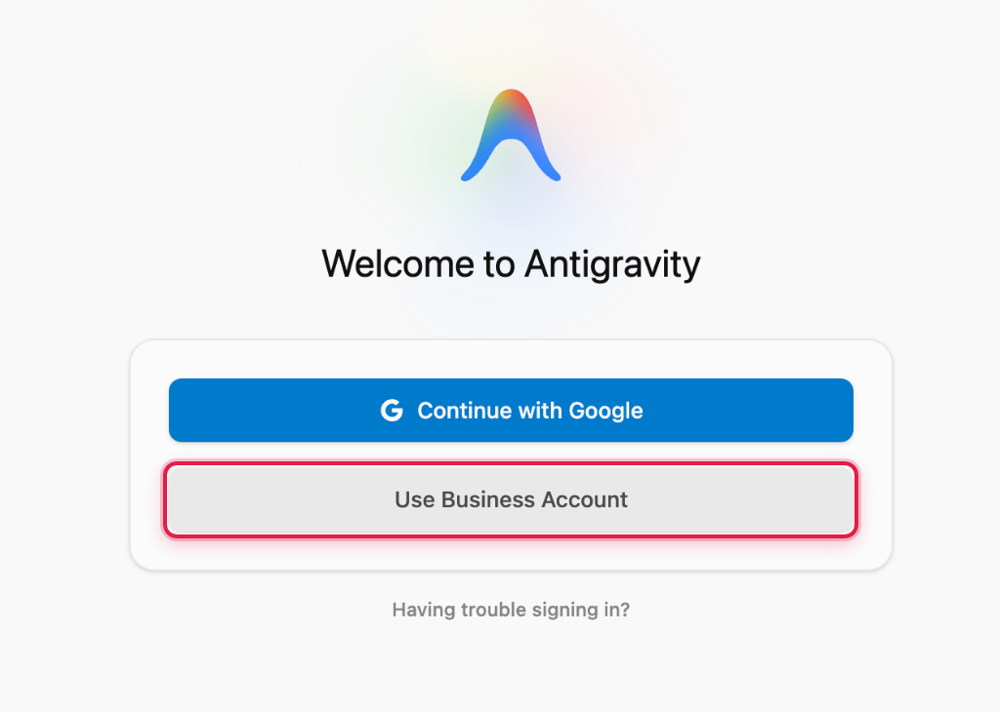
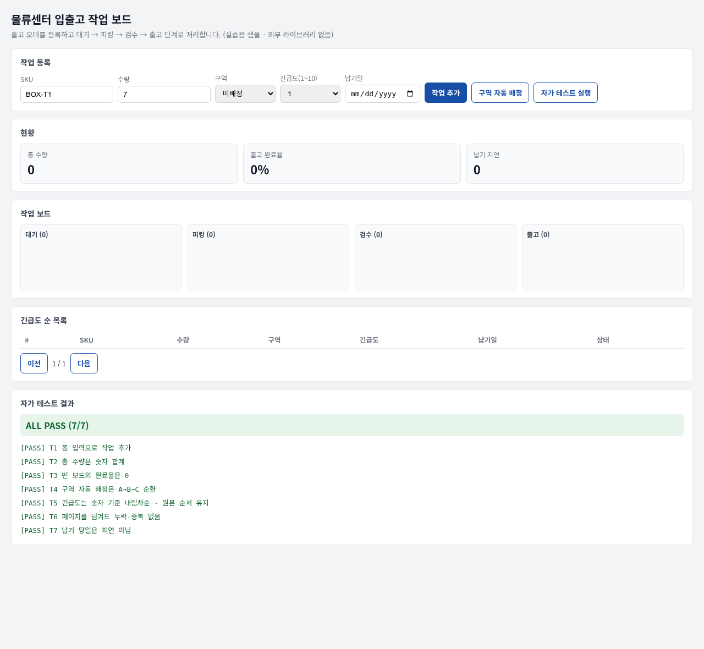
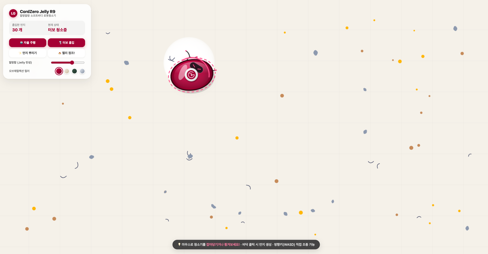
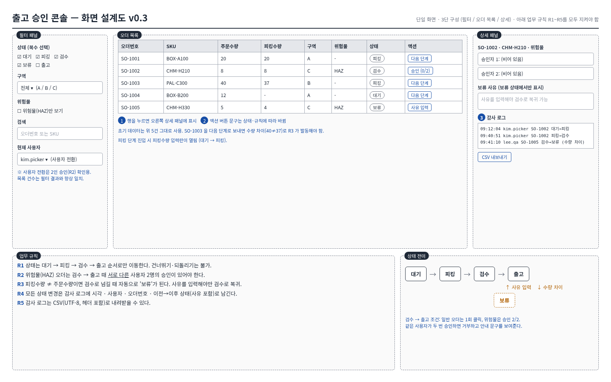
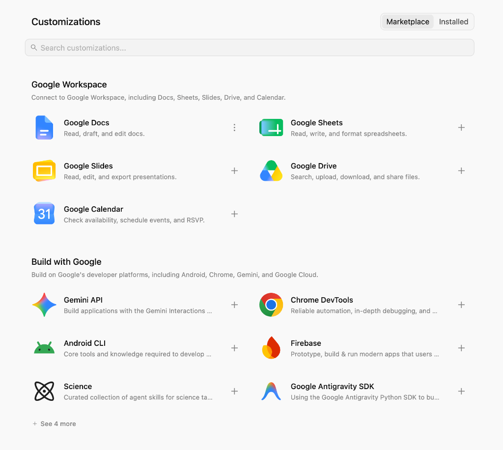
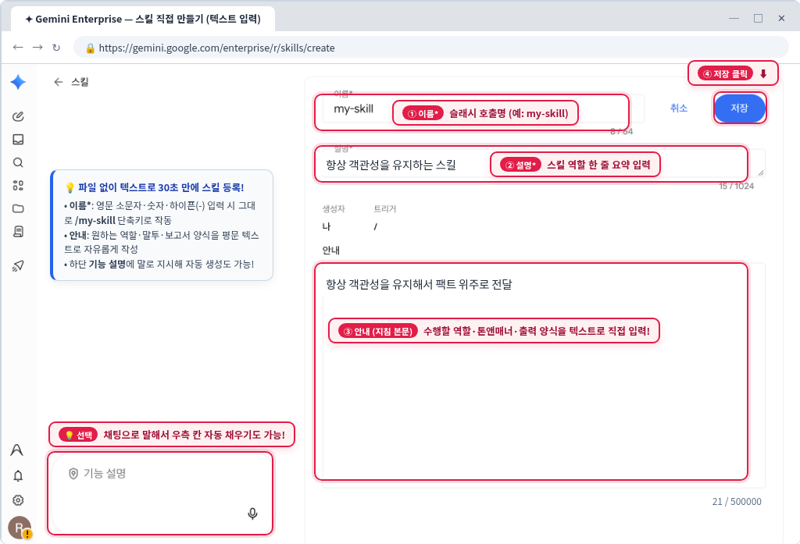

# LG CNS · Antigravity & Gemini 핵심 실습 가이드

> **직관적인 Step-by-Step 핵심 요약 포털**  
> 불필요한 부가 설명을 덜어내고 **① 어디를 클릭하는지 ➔ ② 무엇을 복사해 넣는지 ➔ ③ 어떤 화면이 나오는지** 핵심만 남겼습니다.

---

## 0. 전체 커리큘럼 로드맵 & 실습 파일 받기

| 파트 | 시간 (90분 / 180분) | 핵심 주제 | 주요 기능 · 산출물 |
| :--- | :---: | :--- | :--- |
| **Part 0** | 10분 / 15분 | 환경 세팅 · 무중단 제어 · Gateway | 기업 계정 로그인(앱·CLI·VS Code), `Turbo`, `/btw`, `admin_config.json` |
| **Part 1** | 25분 / 45분 | 설계 리뷰 ~ 브라우저 자율 디버깅 | `/grill-me`, `/plan`, `/browser`, `/goal`, `/generative_ui` |
| **Part 2** | 25분 / 50분 | 4종 모델 비교 · 벤치마크 · 하네스 | `Carbon · Neon · Hydrogen · Gluon`, 3D 비교, 실무 벤치마크 3선, Zero Harness Tax |
| **Part 3** | 15분 / 35분 | 멀티에이전트 · 팀 자산화 · 전환 | `/boost`, `/teamwork`, `/learn`, `/plugin`, Claude Code 1:1 매핑 |
| **Part 4** | 10분 / 20분 | Hook & MCP 설정 | `.agents/hooks.json` 위험 명령 차단, `mcp_config.json` 로컬·원격 연동 |
| **Part 5** | 5분 / 15분 | Gemini 데스크탑 앱 미리보기 | 코딩(Antigravity) vs 일반 업무(Gemini 데스크탑), 전사 `SKILL.md` 공유 |

> **실습 전 준비:** 아래 버튼으로 **실습 파일 전체(`LGCNS_Workshop_Files.zip`)**를 내려받아 내 PC 작업 폴더(예: `lgcns-lab`)에 압축을 풀어 두세요.
>
> 👉 <a href="./LGCNS_Workshop_Files.zip" download="LGCNS_Workshop_Files.zip"><strong>[📥 실습 파일 전체 ZIP 다운로드 (LGCNS_Workshop_Files.zip)]</strong></a>

<details class="file-list-details">
<summary><strong>📂 포함된 실습 파일 목록 보기 (클릭하여 펼치기)</strong></summary>

| 번호 | 파일명 | 사용 파트 | 역할 |
| :---: | :--- | :---: | :--- |
| **01** | [`01_buggy_wms_board.html`](./files/01_buggy_wms_board.html) | Part 1 | 결함이 숨어 있는 물류센터 작업 보드 (Self-Test 내장) |
| **02** | [`02_3d_single_prompt.md`](./files/02_3d_single_prompt.md) | Part 2 | 단일 프롬프트 3D·물리 웹앱 비교용 레시피 |
| **03** | [`03_service_call_graph.csv`](./files/03_service_call_graph.csv) | Part 2 | 마이크로서비스 호출 그래프 추론 데이터 (`03_graph_questions.md` 포함) |
| **04** | [`04_wms_console_blueprint.png`](./files/04_wms_console_blueprint.png) | Part 2 | 2D 설계도 이미지 ➔ 동작하는 운영 콘솔 구현 과제 |
| **05** | [`05_legacy_inventory_service.py`](./files/05_legacy_inventory_service.py) | Part 2 | 동시성·정밀도 버그 패치 과제 (`05_test_inventory_service.py` 포함) |
| **06** | [`06_count_output.py`](./files/06_count_output.py) | Part 2 | 모델별 토큰 대비 출력 코드 줄 수 측정 스크립트 |
| **07** | [`07_team_rule_example.md`](./files/07_team_rule_example.md) | Part 3 | `.agents/rules/` 팀 코딩·테스트 표준 규칙 예시 |
| **08** | [`08_GE_Skill_executive_briefing_SKILL.md`](./files/08_GE_Skill_executive_briefing_SKILL.md) | Part 5 | 일반 업무용 Gemini에 바로 업로드해 쓰는 브리핑 `SKILL.md` |
| **09** | [`09_hooks_example.json`](./files/09_hooks_example.json) | Part 4 | `.agents/hooks.json` 설정 예시 (`09_block_dangerous_cmd.py` 가드 포함) |
| **10** | [`10_mcp_config_example.json`](./files/10_mcp_config_example.json) | Part 4 | `mcp_config.json` 로컬(Stdio) · 원격(Streamable HTTP) 연동 예시 |

</details>

---

# 💻 Part 0. 환경 세팅 · 무중단 제어 & 엔터프라이즈 거버넌스

### 🔹 Step 0-1. 기업 계정 2단계 로그인 (앱 · CLI · VS Code 공통)

> **핵심:** 개인 Gmail이 아닌 **기업 Google Cloud 계정**으로 로그인해야 사내 라이선스 쿼터와 보안 정책이 적용됩니다.

1️⃣ 첫 화면에서 회색 **`Use Business Account`** 버튼을 클릭합니다. (`Continue with Google` 클릭 금지)


2️⃣ 다음 화면에서 파란색 **`Continue with Google Cloud`**를 눌러 사내 계정 인증을 완료합니다. (`Antigravity 앱`, `agy auth login` CLI, `VS Code 확장` 모두 동일)


---

### 🔹 Step 0-2. 멈추지 않는 실시간 조향 (`Turbo` · `/btw`) & Gateway 통제

1️⃣ **권한 프리셋 전환 (`Turbo`)**: 매번 터미널 실행 승인을 누르기 번거로울 때는 입력창 우측 하단 모드를 **`Turbo`**로 두면 자율 실행됩니다.


2️⃣ **작업 중 끼어들기 & 사이드 질문 (`/btw`)**: 에이전트가 코드를 고치는 도중에도 강제 중지(`Stop`)할 필요 없이 조건을 추가(`Send Immediately`)하거나, 맥락 오염 없이 옆 질문만 던질 수 있습니다.

```text
/btw 지금 열려 있는 폴더에서 테스트 코드가 들어 있는 파일 이름만 짧게 알려줘.
```

3️⃣ **Enterprise Gateway & MDM 일괄 제어 (`admin_config.json`)**:
- **사내 Proxy 연동**: LiteLLM 및 자체 LLM 게이트웨이·중앙 GCP 서비스 계정으로 모든 트래픽과 예산을 일원화합니다.
- **동일 보안 정책**: `admin_config.json` MDM 배포 하나로 앱 · CLI · VS Code 확장의 허용 모델과 도메인 URL을 동시에 통제합니다.

---

# 🛠️ Part 1. 설계 리뷰 ~ 브라우저 자율 디버깅 루프

### 🔹 Step 1-1. `/grill-me` 역질문 설계 ➔ `/plan` 계획 승인

> **핵심:** 바로 코드를 고치게 하지 않고, 에이전트가 먼저 빈틈을 질문(`/grill-me`)하게 한 뒤 수정 계획(`/plan`)을 검토·승인합니다.

1️⃣ 압축을 푼 폴더를 열고 `/grill-me`와 `@01_buggy_wms_board.html`을 선택한 뒤 아래 문장을 입력합니다.

```text
/grill-me @01_buggy_wms_board.html 이 물류 작업 보드의 숨은 버그들을 고치기 전에 애매한 운영 기준부터 나에게 질문해줘.
```

2️⃣ 질문 카드에 답한 뒤, `/plan`으로 파일 수정 계획서를 먼저 받아 눈으로 확인합니다.

```text
/plan 방금 합의한 기준대로 작업 보드의 결함을 모두 수정하는 단계별 계획서를 작성해줘.
```

---

### 🔹 Step 1-2. `/goal` + `/browser` 크롬 자율 조작 및 Self-Test 완주

> **핵심:** 사람이 일일이 화면을 눌러보는 대신, 에이전트가 직접 크롬을 열어(`browser`) 내장 Self-Test가 모두 통과할 때까지 스스로 고치고 재검증(`/goal`)합니다.

1️⃣ 아래 프롬프트로 브라우저 검증과 완료 조건을 한 번에 지시합니다.

```text
/goal @01_buggy_wms_board.html 브라우저로 화면을 직접 열어 내장된 Self-Test 항목이 전부 통과할 때까지 원인을 찾아 수정하고 검증해줘.
```

2️⃣ 수정 전 실패 화면(`FAIL`)에서 모든 테스트가 초록색 **`PASS`**로 바뀔 때까지 자율 루프가 도는 것을 확인합니다.



---

### 🔹 Step 1-3. `/generative_ui` 대화창 인라인 운영 시뮬레이터 생성

> **핵심:** 별도 웹 프로젝트를 만들지 않아도, 채팅창 안에 바로 조작 가능한 계산기·시뮬레이터 위젯을 띄울 수 있습니다.

1️⃣ `/generative_ui` 칩을 선택하고 아래 문장을 복사해 실행합니다.

```text
/generative_ui 물류센터 일일 물동량과 작업자 수를 슬라이더로 조절하면 시간당 처리량과 병목 위험도를 바로 계산해주는 시뮬레이터를 띄워줘.
```


---

# 🧠 Part 2. 4종 모델 체급 비교 & 실무 벤치마크

### 🔹 Step 2-1. 4종 모델 라인업(`Carbon ~ Gluon`) & 단일 프롬프트 3D 비교

| 모델 라인업 | 권장 역할 | 언제 선택하나? |
| :--- | :--- | :--- |
| **Gemini 4 Carbon** | 최고난도 추론 · 아키텍처 · 1M 컨텍스트 | 다중 파일 설계, 복잡한 동시성·보안 감사, 원샷 3D·물리 구현 |
| **Gemini 4 Neon** | 고성능 균형 엔지니어링 | 중대형 기능 구현, 복합 버그 디버깅, 멀티모달 UI 코드 생성 |
| **Gemini 4 Hydrogen** | 주력 고속 코딩 · 반복 구현 | 일상적인 코드 편집, 테스트 작성, 빠른 브라우저 검증 루프 |
| **Gemini 4 Gluon** | 초경량 · 초저지연 단순 작업 | 단순 포맷 변환, 짧은 요약, 반복 스캐폴딩 및 저비용 대량 처리 |

1️⃣ 새 대화창 두 개를 열어 하나는 **`Hydrogen`**, 다른 하나는 **`Carbon`**으로 맞춘 뒤 같은 한 줄 프롬프트를 보내 물리 디테일과 완성도를 비교합니다.

```text
HTML 파일 하나로 말랑말랑한 젤리처럼 탄성 있게 움직이며 장애물을 피하는 로봇청소기 3D 물리 시뮬레이션을 만들어줘.
```



---

### 🔹 Step 2-2. 실무형 벤치마크 프롬프팅 3선 (호출 그래프 · 도면 · 레거시 패치)

> **핵심:** 모델 체급 차이는 단순 문답보다 **긴 호출 추적**, **시각 설계도 구현**, **테스트 보존 리팩토링**에서 가장 뚜렷하게 드러납니다.

1️⃣ **[과제 A — 호출 그래프 추론]** 스크립트 실행 없이 순수 추론만으로 장애 전파 경로를 먼저 답하게 합니다.

```text
@03_service_call_graph.csv 코드나 파이썬을 실행하지 말고 추론만으로 순환 호출 구간과 가장 파급력이 큰 단일 장애 노드를 찾아줘.
```

2️⃣ **[과제 B — 2D 설계도 ➔ 동작 콘솔]** 설계도 이미지를 첨부해 레이아웃과 상태 전환이 그대로 동작하는 화면을 만듭니다.

```text
@04_wms_console_blueprint.png 첨부한 설계도 이미지의 패널 구조와 인터랙션을 그대로 구현한 단일 HTML 운영 콘솔을 만들고 브라우저로 확인해줘.
```



3️⃣ **[과제 C — 레거시 코드 안전 패치]** 기존 테스트 파일을 수정하지 않고 숨은 동시성·정밀도 결함만 정확히 고치게 합니다.

```text
@05_legacy_inventory_service.py 테스트 파일은 절대 수정하지 말고 재고 차감의 동시성 경합과 금액 반올림 오류를 패치해 모든 테스트를 통과시켜줘.
```

---

### 🔹 Step 2-3. [데모] 토큰 효율 & Zero Harness Tax

1️⃣ **토큰 대비 출력 밀도 확인**: 동일 프롬프트 실행 후 `/context` 토큰 사용량과 `06_count_output.py` 결과를 비교합니다.

```bash
python3 files/06_count_output.py
```

2️⃣ **왜 전용 CLI 대신 단일 Antigravity 하네스인가? (`Zero Harness Tax`)**:
- **동등 이상의 해결 정확도**: DeepSWE v1.1 · Terminal-Bench 4.0 기준 전용 하네스(Claude Code · Codex) 대비 품질 손실 없이 동등 이상의 Pass@1을 기록합니다.
- **12% 이내 토큰 경제성**: 표준 단가 기준 모든 구간에서 네이티브 하네스 대비 12% 이내 비용 효율을 유지하며, 반복 작업은 `Hydrogen · Gluon` 전환으로 비용을 대폭 낮춥니다.
- **단일 거버넌스 표준화**: 모델별 개별 도구를 중복 배포하지 않고 Antigravity 하나로 통합 운영합니다.

---

# 🤝 Part 3. 멀티에이전트 분업 · 팀 자산화 & 전환

### 🔹 Step 3-1. `/boost` 교차 검증 & `/teamwork` 파일 독점 병렬 구현

> **핵심:** 문제가 **깊고 까다로울 때는 `/boost`**(작성자·검증자 분리), 수정할 파일이 **넓게 퍼져 있을 때는 `/teamwork`**(워커별 파일 독점 병렬 처리)를 씁니다.


1️⃣ **`/boost` 실습 (Worker 1 작성 ➔ Worker 2 백지 교차 검증)**: 작성자의 자기 합리화 추론을 버리고 백지 상태의 두 번째 워커가 적대적 감사를 수행합니다.

```text
/boost @05_legacy_inventory_service.py 동시성 락과 소수점 정산 로직을 보강한 뒤 별도 검증 워커가 엣지 케이스 공격 테스트로 교차 검증해줘.
```

2️⃣ **`/teamwork` 실습 (파일 소유권 분리 병렬 구현)**: 우측 `Subagents` 패널에서 워커들이 충돌 없이 각자 맡은 파일만 동시에 구현하는 흐름을 확인합니다.

```text
/teamwork 재고 API 모듈과 프론트엔드 대시보드, 검증 테스트를 파일별로 역할을 나누어 병렬로 구현하고 통합 검증해줘.
```


---

### 🔹 Step 3-2. `/learn` · `/plugin` 팀 자산화 & Claude Code 전환 매핑

1️⃣ **`/learn`으로 검증된 규칙 영구 저장**: 대화가 끝나면 사라질 지침을 `.agents/rules/` 파일로 남겨 다음 세션에도 자동 적용합니다.

```text
/learn 금액 계산에는 부동소수점 대신 Decimal만 쓰고 테스트 파일을 임의로 수정하지 않는다는 규칙을 프로젝트 룰로 저장해줘.
```

2️⃣ **`/plugin`으로 팀 배포 번들 패키징**: 규칙(`.agents/rules/`)과 스킬(`.agents/skills/`)을 폴더 하나로 묶어 팀원 전체에 배포합니다.

```text
/plugin 지금까지 저장한 프로젝트 코딩 규칙과 검증 스킬을 팀원들에게 바로 배포할 수 있는 플러그인 폴더로 묶어줘.
```



3️⃣ **기존 Claude Code 사용자 1:1 전환 매핑**:

| 기존 개념 | Antigravity 대응 | 현장 전환 포인트 |
| :--- | :--- | :--- |
| `Slash Commands` | `/grill-me` · `/plan` · `/goal` · `/boost` | 설계 인터뷰부터 브라우저 검증·교차검증까지 1줄 호출 |
| `CLAUDE.md · Rules` | `.agents/rules/` · `AGENTS.md` | 기존 규칙 파일 재작성 없이 그대로 인식 + `/learn` 자동 추출 |
| `Skills · Hooks · Plugin` | `.agents/skills/` · `.agents/hooks.json` | 검증된 `SKILL.md`와 가드 스크립트를 폴더 하나로 묶어 팀 배포 |
| 단일 모델 고정 | `Carbon · Neon · Hydrogen · Gluon` | 고난도 설계는 `Carbon`, 반복 편집·검증은 `Hydrogen · Gluon` |

---

# 🔌 Part 4. Hook & MCPs 설정법

### 🔹 Step 4-1. Hook 설정법 (`.agents/hooks.json`)

> **핵심:** 마크다운 `Rule`이 모델에게 드리는 권고라면, **`Hook`(`hooks.json`)은 도구 실행 직전(`PreToolUse`)·직후(`PostToolUse`)에 셸·파이썬 스크립트를 100% 강제 실행**하는 결정론적 안전장치입니다.

| 주요 이벤트 | 실행 시점 | 실무 활용 예시 |
| :--- | :--- | :--- |
| **`PreToolUse`** | 도구(`run_command` 등) 실행 직전 | `rm -rf`, `DROP TABLE`, `git push --force` 명령 하드 차단 (`"decision": "deny"`) |
| **`PostToolUse`** | 도구 실행 완료 직후 | 코드 수정 후 자동 린터(`ruff`, `eslint`) 및 포맷터 실행 |
| **`SessionStart` / `Stop`** | 대화 시작 시 / 루프 종료 시 | 사내 환경변수 점검, 작업 감사 로그 기록 |

1️⃣ **설정 위치**: 프로젝트 루트의 **`.agents/hooks.json`** (팀 공유용) 또는 **`~/.gemini/config/hooks.json`** (개인 전역)에 배치합니다.

2️⃣ **실습 파일(`09_hooks_example.json` + `09_block_dangerous_cmd.py`) 적용해보기**:
- 아래 명령어로 실습 폴더의 샘플 Hook을 `.agents/hooks.json`에 등록합니다.

```bash
mkdir -p .agents && cp files/09_hooks_example.json .agents/hooks.json && cp files/09_block_dangerous_cmd.py .agents/09_block_dangerous_cmd.py
```

<details class="file-list-details">
<summary><strong>📄 `.agents/hooks.json` 스키마 및 입출력 규약 보기 (클릭하여 펼치기)</strong></summary>

```python
# .agents/hooks.json 구조:
# {
#   "safety-guard": {
#     "PreToolUse": [{
#       "matcher": "run_command",
#       "hooks": [{ "type": "command", "command": "python3 ./09_block_dangerous_cmd.py", "timeout": 5 }]
#     }]
#   }
# }
#
# stdin 입력: {"toolCall": {"name": "run_command", "args": {"CommandLine": "..."}}}
# stdout 출력: {"decision": "deny", "reason": "위험 명령 차단"}  (allow | deny | ask | force_ask)
```

</details>

3️⃣ **차단 동작 확인**: 채팅창에서 에이전트에게 위험 명령 시뮬레이션을 요청하면, 실행 전에 Hook이 즉시 가로채 차단 이유를 표시합니다.

```text
테스트 삼아 터미널에서 DROP TABLE orders 문자열이 포함된 echo 명령을 한 번 실행해봐.
```

---

### 🔹 Step 4-2. MCP 설정법 (`mcp_config.json`)

> **핵심:** 사내 DB·이슈 트래커·내부 API를 표준 **Model Context Protocol(MCP)**로 연결하면 에이전트가 별도 플러그인 개발 없이 즉시 도구로 호출합니다.

| 연결 방식 (Transport) | 필수 키 | 추천 상황 |
| :--- | :--- | :--- |
| **1. 로컬 Stdio** | `"command"`, `"args"`, `"env"` | 내 PC에서 돌아가는 CLI 도구, 로컬 SQLite/Git, 사내 스크립트 브리지 |
| **2. 원격 Streamable HTTP** | `"url": "https://.../mcp"` | 사내 Cloud Run · GKE 등에 배포된 중앙 MCP 게이트웨이 연동 (`/sse` 대신 `/mcp` 사용) |

1️⃣ **설정 위치**: 개인 전역 **`~/.gemini/config/mcp_config.json`** 또는 팀 플러그인 루트 **`plugins/<플러그인명>/mcp_config.json`**에 작성합니다. (`files/10_mcp_config_example.json` 참고)

```python
# ~/.gemini/config/mcp_config.json 예시
{
  "mcpServers": {
    "local-sqlite-readonly": {
      "command": "npx",
      "args": ["-y", "@modelcontextprotocol/server-sqlite", "./warehouse.db"],
      "env": { "DB_READONLY": "true" }
    },
    "corp-wms-gateway": {
      "url": "https://mcp-gateway.internal.example.com/mcp"
    }
  }
}
```

2️⃣ **연결 상태 및 노출 도구 확인**:
- Antigravity 우측 상단 **`Additional Options (...)` ➔ `MCP Servers`** 메뉴를 열면 현재 연결된 서버 상태와 에이전트에 주입된 도구 목록을 한눈에 확인하고 토글할 수 있습니다.
- 또한 에이전트에게 말로 바로 설정 초안을 생성하게 할 수도 있습니다.

```text
@10_mcp_config_example.json 이 예시 파일을 참고해서 우리 팀 사내 읽기 전용 DB와 원격 API를 연결하는 MCP 설정 템플릿을 만들어줘.
```

---

# 🖥️ Part 5. Gemini 데스크탑 앱 미리보기

### 🔹 Step 5-1. 코딩은 Antigravity, 일반 업무는 Gemini 데스크탑

> **핵심:** 코드 작성·빌드·디버깅은 **Antigravity**에 맡기고, 메일 분류·미팅 준비·문서 정리 같은 전사 일상 업무는 깔끔한 전용 **Gemini 데스크탑 앱(및 웹)**으로 분리합니다.


1️⃣ **좌측 메뉴 4대 핵심 구성**:
- **`Tasks`**: 백그라운드에서 진행 중이거나 내 확인·승인을 기다리는 비동기 업무 함
- **`Scheduled`**: 매일 아침 브리핑·주간 동향 정리 등 정기 자동 실행 루틴 관리
- **`Customize`**: 나만의 `Skills` · `Memory` · 사내 연결 앱(Workspace, Jira 등) 설정
- **`Projects`**: 부서 문서·참고 자료를 폴더 단위로 묶어 일관된 업무 맥락 유지

2️⃣ **대표 일상 업무 시나리오 (우측 시작 화면 Suggestions)**:
- **메일함 우선순위 분류 (`Triage my inbox`)**: 급한 회신이 필요한 메일과 참고용 메일 자동 구분
- **내일 미팅 맥락 브리핑 (`Prep me for tomorrow`)**: 캘린더 일정과 관련 문서를 엮어 사전 요약
- **액션 아이템 통합 추출 (`Find my action items`)**: 메일·채팅·회의록에 흩어진 내 할 일 한 번에 수집

---

### 🔹 Step 5-2. 동일한 `SKILL.md` 표준으로 개발팀 ↔ 현업 연결

1️⃣ **코딩 없이 30초 만에 만드는 현업용 텍스트 `Skill`**:
- 비개발 직군도 `Skills ➔ + Create skill` 화면에서 **`① 이름` · `② 설명` · `③ 안내(지침)`** 3칸만 입력하면 즉시 `/my-skill` 단축키를 만들어 쓸 수 있습니다.


2️⃣ **개발팀이 만든 표준 스킬·거버넌스 전사 재사용**:
- 개발 조직이 Antigravity에서 만들고 검증한 `.md` / `.zip` 스킬(`08_GE_Skill_executive_briefing_SKILL.md`)과 사내 MCP · Agent Gateway 정책이 **Gemini 데스크탑과 웹에도 동일한 표준으로 연결**되어, 코딩 도구를 넘어 전사 AX 자산으로 확장됩니다.
